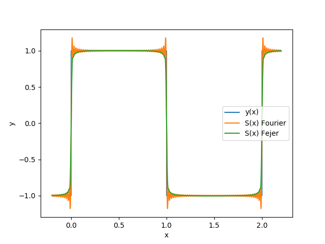

# Fejér summation

The [Fourier series](http://mathworld.wolfram.com/FourierSeries.html) representation of a square wave $`y(x)`$ with period $`L`$ is:
```math
S(x) = \frac{4}{\pi} \sum_{j=1,3,5,...}^{\infty} \frac{1}{j} \sin\left( \frac{j \pi x}{L} \right)
```

The [Gibbs phenomenon](https://en.wikipedia.org/wiki/Gibbs_phenomenon) leads to _ugly_ overshoots near the discontinuities (see plot below). This can be mitigated through Fejér summation (see `fejer.py` for the implementation).


