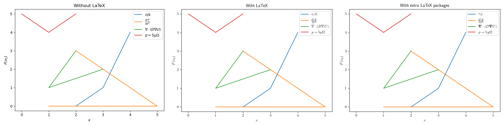

# Pretty matplotlib plots with full LaTeX support

For high-quality plots, especially for integration in documents typeset in LaTeX, using the $`\LaTeX`$ font for axis labels and legends is desirable. Not only does it look better than the default font, with a little extra work we can import LaTeX packages for special symbols and expressions.

The code below creates three figures (shown here):
- Without LaTeX enabled, using the default matplotlib settings.
- With LaTeX enabled, using standard LaTeX maths commands.
- With LaTeX enabled and extra packages loaded.

